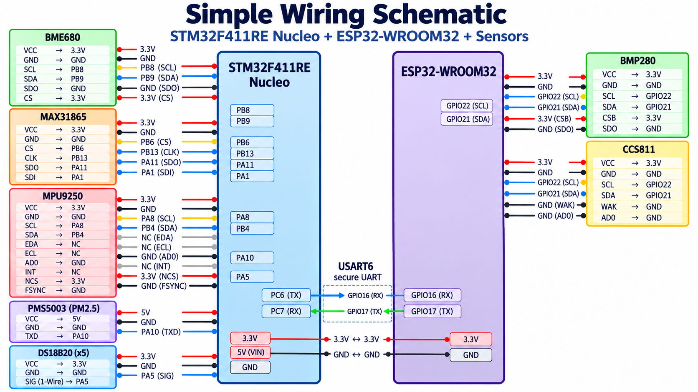
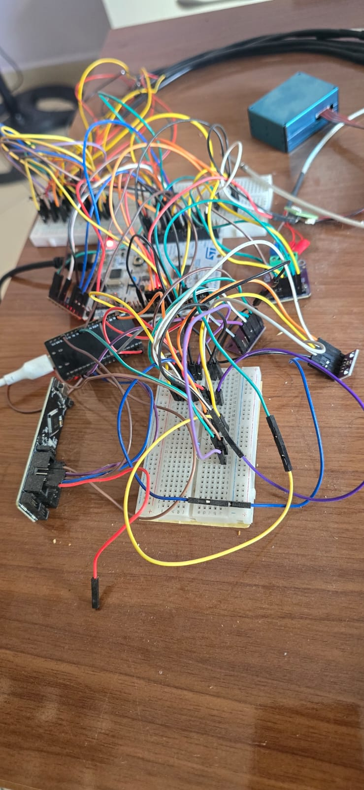

# Secure STM32–ESP32 IoT Sensor Platform

## System Architecture

The diagram below illustrates the STM32–ESP32 platform, including sensor acquisition, secure boot, AES-GCM communication, fault recovery, and cloud integration.

[STM32–ESP32 System Architecture](https://github.com/krisiqyra/secure-embedded-fusion/blob/main/docs/system-architecture.svg)

## Technical Implementation

I implemented secure boot using STM32CryptoLib with Ed25519 signature verification and SHA-256 integrity checks. On reset, I verify the signed manifest in sector 7 (0x08060000) and hash the application in sectors 5–6 (0x08020000–0x0805FFFF, 256 KiB). Both checks must pass before execution. The public and private keys are stored in OTP at 0x1FFF7800, with 512 data bytes and 16 lock bytes. Before jumping, I validate the stack pointer and reset handler, stop SysTick, clear interrupt state and configure the vector table. I tested firmware, signature and public-key corruption to confirm execution is blocked when verification fails.

On the STM32, I use BME680 and MPU9250 over I²C, MAX31865/PT100 over SPI, PMS5003 over UART and five DS18B20 sensors over 1-Wire. FreeRTOS tasks send readings through queues, DMA interrupts signal binary semaphores, and a mutex protects USART2 logging. I²C recovery stops DMA, clears the bus state and applies SWRST or an APB reset when needed before reinitialization. Persistent failures after three recovery attempts, or missed heartbeats, escalate to a watchdog reset.

The USART6 link uses full-duplex AES-256-GCM with STM32CryptoLib and mbedTLS. Telemetry and encrypted ACK/NACK replies undergo authentication, sequence and replay checks. I allow three transaction attempts with timeouts, UART cleanup and fresh nonces, advancing the request sequence only after a valid ACK. Successful transactions refresh the heartbeat; exhausted retries escalate to the watchdog. Nonce state persists in nonvolatile memory, and every reset repeats secure boot. I tested corruption, replay and counter/session mismatches.

On the ESP32, I publish combined sensor readings as JSON to AWS IoT Core over MQTT/TLS. A root CA verifies AWS, while a device certificate and private key authenticate the ESP32. The task handles keepalive, reconnection, subscribed messages and watchdog heartbeats.

The local HTTPS dashboard displays live sensor readings through JSON endpoints and supports Wi-Fi configuration and ESP32 OTA updates. To manage TLS memory use, I stop AWS before enabling HTTPS for an access-point client, then switch back to cloud mode after the last client disconnects and the station connection is available.

## Hardware Connections and Wiring Schematic

The figure below shows the hardware wiring connections between the STM32F411RE Nucleo, ESP32-WROOM32, and connected sensors.

[View Full Hardware Schematic](https://github.com/krisiqyra/secure-embedded-fusion/blob/main/docs/hardware_connections/stm32-esp32-wiring-schematic.png)

## Physical Hardware Prototype

The photograph below shows the physical STM32–ESP32 prototype, including the connected sensor modules, breadboards, jumper wires, and microcontroller development boards used during testing.

[View Full Hardware Picture](https://github.com/krisiqyra/secure-embedded-fusion/blob/main/docs/hardware_connections/hardware_image.jpeg)

### Hardware Video

The following video shows the physical hardware assembly and its connections.

[Watch Hardware Video](https://github.com/krisiqyra/secure-embedded-fusion/blob/main/docs/hardware_connections/hardware_vid.mp4)

## Interactive Doxygen Documentation

Complete STM32–ESP32 firmware documentation, including function references, source-code navigation, call graphs, dependency diagrams, and cryptographic interfaces.

[View Interactive Doxygen Documentation](https://secure-fusion-doxygen-598a13.gitlab.io)

## Engineering Evidence

### Firmware Development Evolution

Ten selected engineering milestones documenting the evolution of the STM32–ESP32 firmware, with historical Git revisions and corresponding demonstration evidence.

[View Development Evolution](https://github.com/krisiqyra/secure-embedded-fusion/blob/main/docs/development-evolution.md)

### Complete System Runtime Demonstrations

Twelve runtime demonstrations covering secure boot, OTP, AES-GCM communication, fault injection, replay protection, watchdog recovery, AWS IoT, HTTPS monitoring, and OTA.

Includes links to the STM32 application, ESP32 application, and secure bootloader source code.

[View Runtime Demonstrations](https://github.com/krisiqyra/secure-embedded-fusion/blob/main/docs/runtime-demonstrations.md)